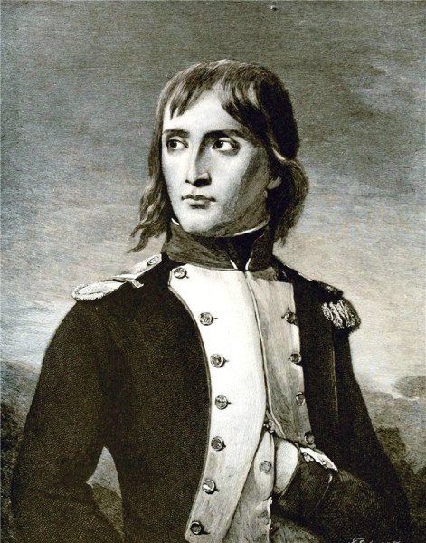
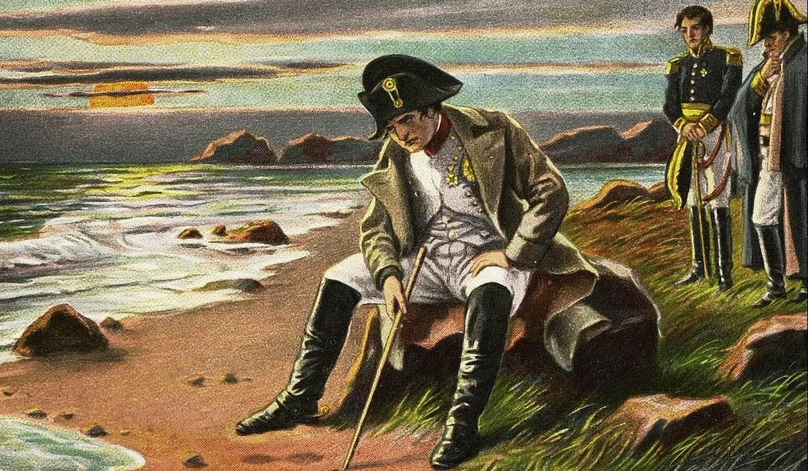

<!DOCTYPE html>
<html lang="ru">
<head>
    <meta charset="UTF-8">
    <title>Наполеон Бонапарт: путь к империи</title>
    
</head>
<body>
    <header>
        <h1>Наполеон Бонапарт: путь к империи</h1>
        <nav>
            <a href="#carousel">Галерея</a>
            <a href="#bio">Биография</a>
            <a href="#wars">Сражения</a>
            <a href="#reforms">Реформы</a>
        </nav>
    </header>

    <main>
        <section id="carousel" class="card">
            <h2>Галерея: Наполеон в разные годы</h2>

            

                <button class="carousel-btn prev" id="prevBtn" aria-label="Назад">&#10094;</button>
                <button class="carousel-btn next" id="nextBtn" aria-label="Вперед">&#10095;</button>

                    

                    
                    

                        
                        
Наполеон в молодости — путь от артиллерийского офицера к славе.

                    

                    
                    

                        
                        
Император Наполеон I — символ власти и военной славы Франции.

                    

                    
                    

                        
                        
Последние годы на острове Святой Елены — закат великой карьеры.

                    

                    
                    

                        
                        
Наполеон в парадной военной форме — образ полководца.

                    

                

                
                

            

        </section>

        
        <section id="bio" class="card">
            <h2>Биография: от Корсики до Тюильри</h2>
            
Наполеон I Бонапарт (1769–1821) — французский полководец, государственный деятель, император Франции в 1804–1814 и в 1815 году. Родился на острове Корсика, который незадолго до этого перешёл под власть Франции. С детства проявлял интерес к математике и военной истории, поступил в военное училище и быстро сделал карьеру в революционной армии.

            
Его стремительный взлёт — редкий пример, когда талант, дисциплина и удача совпали в одной эпохе. Уже к 24 годам он стал бригадным генералом, а в 30 — фактически главой государства.

        </section>

        
        <section id="wars" class="card">
    <h2>Ключевые сражения</h2>
    <table>
        <thead>
            <tr>
                <th>Год</th>
                <th>Сражение</th>
                <th>Значение</th>
            </tr>
        </thead>
        <tbody>
            <tr>
                <td>1805</td>
                <td><a href="#austerlitz" class="battle-link">Аустерлиц</a></td>
                <td>Решающая победа над русско-австрийскими войсками («Битва трёх императоров»).</td>
            </tr>
            <tr>
                <td>1805</td>
                <td><a href="#trafalgar" class="battle-link">Трафальгар</a></td>
                <td>Поражение франко-испанского флота, господство Британии на море.</td>
            </tr>
            <tr>
                <td>1812</td>
                <td><a href="#borodino" class="battle-link">Бородинское сражение</a></td>
                <td>Крупнейшая битва кампании в России, стратегическая катастрофа для Наполеона.</td>
            </tr>
            <tr>
                <td>1813</td>
                <td><a href="#leipzig" class="battle-link">Лейпциг («Битва народов»)</a></td>
                <td>Решающее поражение коалиции, начало конца империи.</td>
            </tr>
            <tr>
                <td>1815</td>
                <td><a href="#waterloo" class="battle-link">Ватерлоо</a></td>
                <td>Окончательное поражение от войск герцога Веллингтона и Блюхера.</td>
            </tr>
        </tbody>
    </table>
</section>

        
        <section id="reforms" class="card">
            <h2>Реформы и наследие</h2>
            <ul>
                <li><strong>Гражданский кодекс (Кодекс Наполеона, 1804)</strong> — унифицировал право Франции, стал образцом для многих стран мира.</li>
                <li><strong>Банк Франции (1800)</strong> — стабилизировал финансы и валюту.</li>
                <li><strong>Система лицеев (1802)</strong> — единая сеть государственных школ.</li>
                <li><strong>Конкордат с Папой (1801)</strong> — урегулировал отношения государства и церкви после революции.</li>
            </ul>
        </section>
<section id="austerlitz" class="card" style="margin-top: 2rem;">
    <h2>Аустерлиц (1805)</h2>
    
<strong>«Битва трёх императоров»</strong> стала вершиной военного гения Наполеона. Он намеренно создал видимость слабости, заманив союзные русско-австрийские войска в наступление.

    
Ключевым моментом стала атака на Праценские высоты, которая расколола армию союзников надвое. Победа позволила Наполеону диктовать условия мира и фактически распустить Третью коалицию.

</section>

<section id="trafalgar" class="card" style="margin-top: 2rem;">
    <h2>Трафальгар (1805)</h2>
    
Это морское сражение стало катастрофой для планов Наполеона по вторжению в Англию. Несмотря на гибель адмирала Нельсона, британский флот под его командованием разгромил объединённые силы Франции и Испании.

    
Англия сохранила господство на морях на весь XIX век, а Наполеон был вынужден отказаться от высадки на Британские острова и сосредоточиться на войнах в Европе.

</section>

<section id="borodino" class="card" style="margin-top: 2rem;">
    <h2>Бородинское сражение (1812)</h2>
    
Одно из самых кровопролитных однодневных сражений в истории. Хотя формально поле боя осталось за французами, русская армия под командованием Кутузова сохранила боеспособность.

    
Потери были колоссальными с обеих сторон. Для Наполеона взятие Москвы не принесло победы, а лишь стало началом гибели его «Великой армии» из-за пожара, голода и суровой зимы.

</section>

<section id="leipzig" class="card" style="margin-top: 2rem;">
    <h2>Лейпциг (1813)</h2>
    
Известная как «Битва народов», она собрала на поле боя войска почти всей Европы против Франции. Силы коалиции (Россия, Пруссия, Австрия, Швеция) значительно превосходили армию Наполеона.

    
Поражение под Лейпцигом привело к освобождению Германии от французского владычества и вынудило Наполеона отступить за Рейн, к границам Франции.

</section>

<section id="waterloo" class="card" style="margin-top: 2rem;">
    <h2>Ватерлоо (1815)</h2>
    
Последнее крупное сражение Наполеона, произошедшее после его возвращения с острова Эльба («Сто дней»). Армии герцога Веллингтона и прусские войска под командованием Блюхера нанесли ему сокрушительный удар.

    
После Ватерлоо Наполеон был сослан на остров Святой Елены, где и провёл остаток жизни. Это сражение окончательно положило конец наполеоновским войнам.

</section>
    </main>

    <footer>
        
&copy; 2026 Учебный проект по информатике. Автор: Абрахимова Анастасия.

    </footer>

    
    
</body>
</html>
